

# 🛡️ TP10 - DevSecOps "Shift Left"
### Secrets, SAST, Dépendances, Images & CI/CD

📄 **[Télécharger le rapport complet (PDF)](rapport_tp10.pdf)**

---

## 🎯 Objectifs du TP

Ce TP a pour but d'appliquer les principes du **Shift Left** en intégrant la sécurité le plus tôt possible dans le cycle de développement :

- **Secrets** : Détecter et bloquer les secrets (Gitleaks, pre-commit).
- **SAST** : Analyser le code statique (Semgrep, CodeQL).
- **SCA** : Auditer les dépendances (npm audit, OWASP Dependency-Check, Dependabot).
- **Images** : Scanner les images et configurations (Trivy).
- **CI/CD** : Mettre en place des quality gates (GitHub Actions, Jenkins).

---

## 📝 Description

Le projet analyse une application volontairement vulnérable (`vuln-app`) et corrige ses failles :
1.  Détection des secrets avec **Gitleaks** et le hook **pre-commit**.
2.  Analyse statique avec **Semgrep** (Injection SQL, XSS, etc.).
3.  Audit des dépendances avec **npm audit** et **OWASP**.
4.  Scan des images avec **Trivy** (avant/après correction du Dockerfile).
5.  Sécurisation de GitHub avec **Dependabot**, **CodeQL**, et **Rulesets**.
6.  Pipeline **Jenkins** avec quality gates (Rouge puis Vert).

---

## 📸 Captures d'écran

Toutes les captures sont disponibles dans le dossier [`captures/`](captures/).

### 🔑 Partie 1 : Secrets avec Gitleaks

#### 1. Détection des secrets (AVANT)
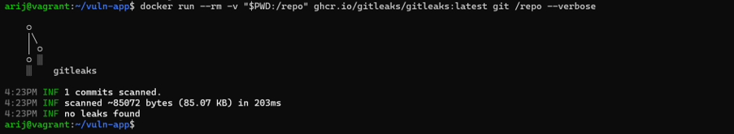

#### 2. Après nettoyage de l'historique
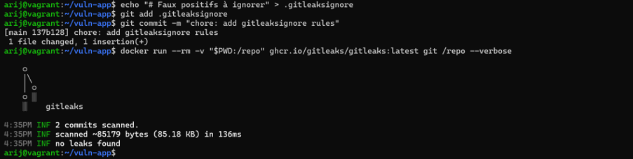

### 🛡️ Partie 2 : Hook pre-commit

#### 3. Installation du hook
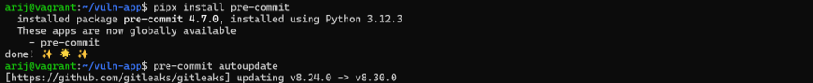

#### 4. Commit bloqué par le hook
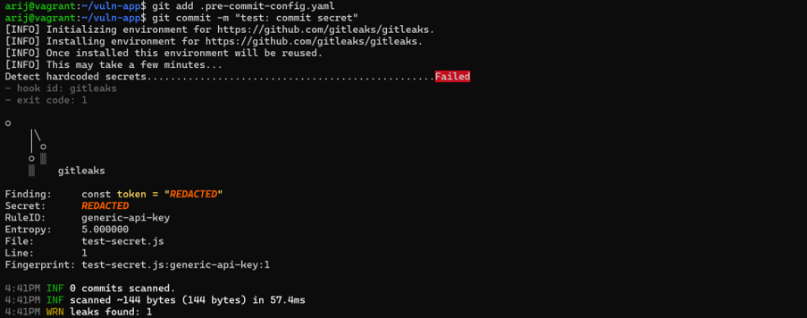

### 🔍 Partie 3 : SAST avec Semgrep

#### 5. Résultats Semgrep (AVANT correction)
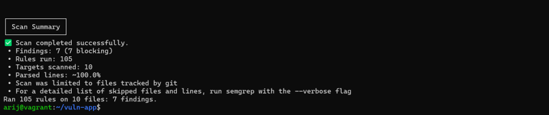

#### 6. Résultats Semgrep (APRÈS correction)
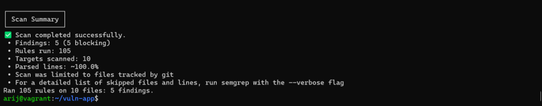

#### 7. Commit des corrections
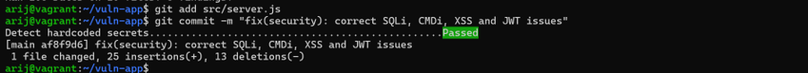

### 📦 Partie 4 : Dépendances et Images

#### 8. npm audit (AVANT)
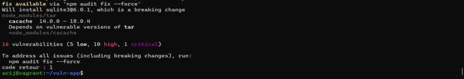

#### 9. OWASP Dependency-Check
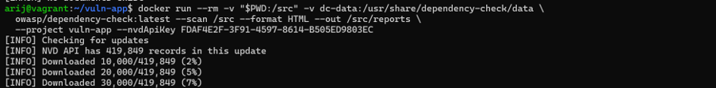

#### 10. Trivy Image (AVANT)
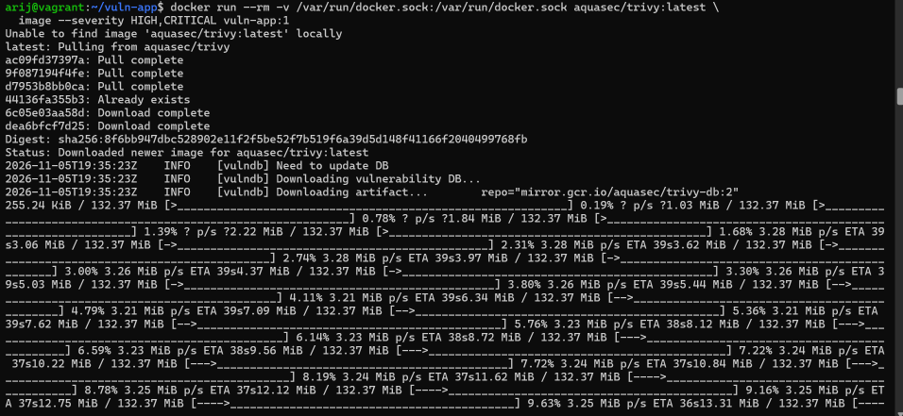

#### 11. Trivy Config (AVANT)
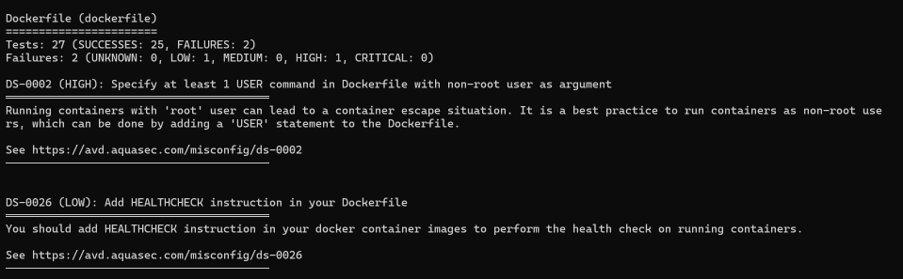

#### 12. Trivy après correction (0 CVE)
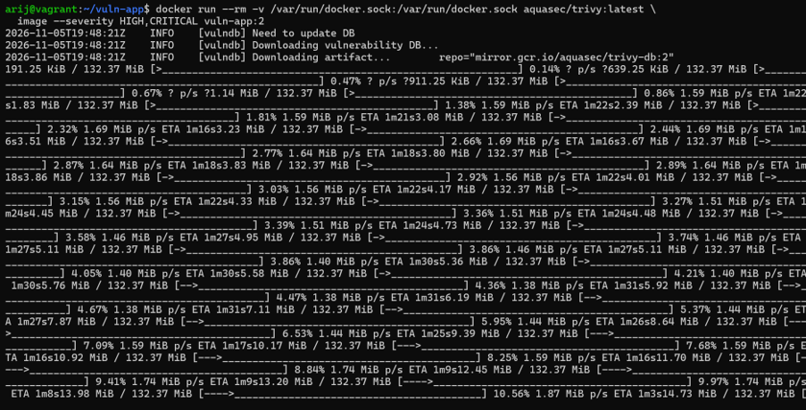

### 🐙 Partie 5 : Sécurité GitHub

#### 13. Activation des fonctionnalités de sécurité
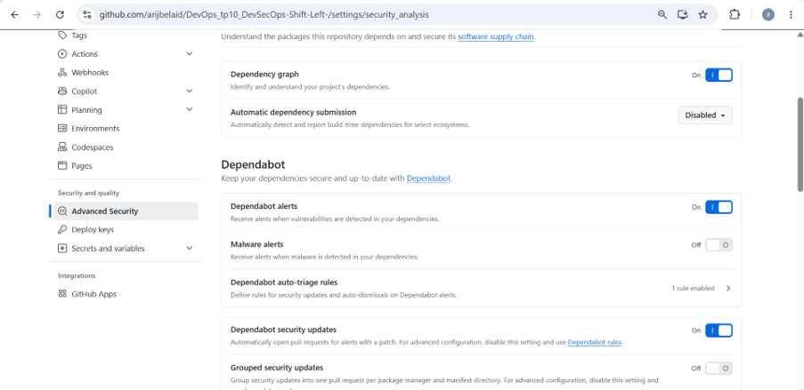

#### 14. Configuration de Dependabot
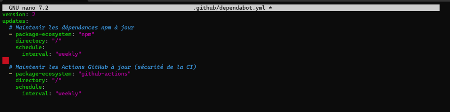

#### 15. Push de la configuration
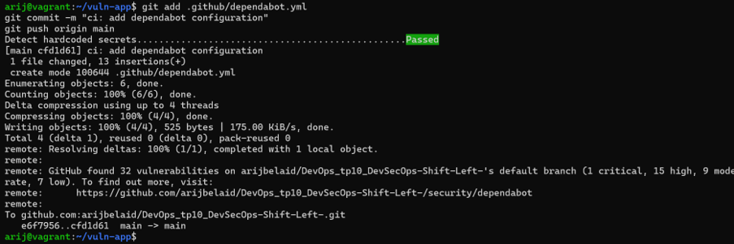

#### 16. Activation de CodeQL
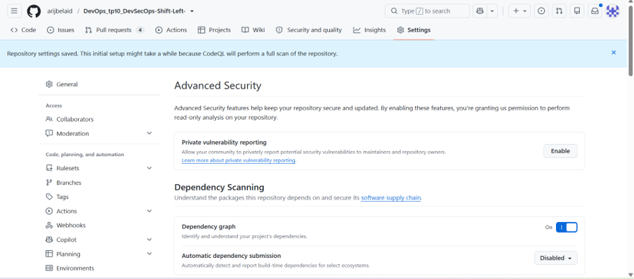

#### 17. Workflow sécurisé (security.yml)
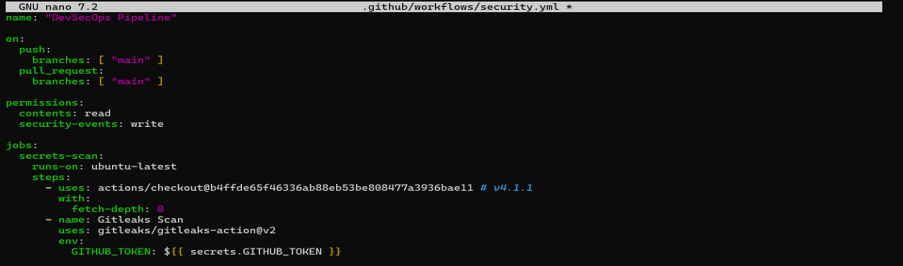

#### 18. Protection de la branche main
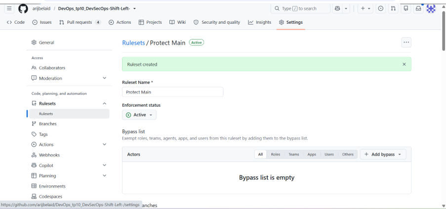

#### 19. PR bloquée par le Ruleset
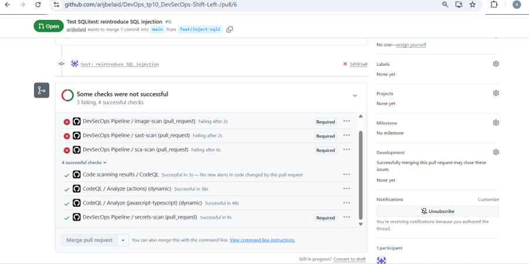

### 🚦 Partie 6 : Quality Gates dans Jenkins

#### 20. Configuration du Job Jenkins
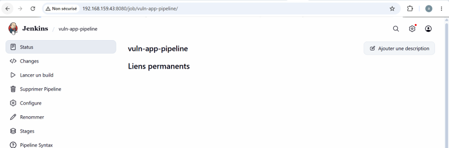

#### 21. Pipeline Jenkins (ROUGE - avec faille)
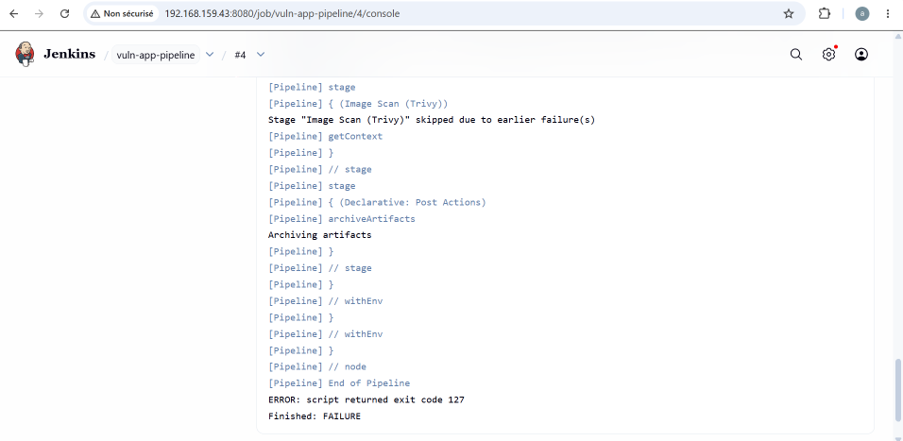

#### 22. Pipeline Jenkins (VERT - corrigé)
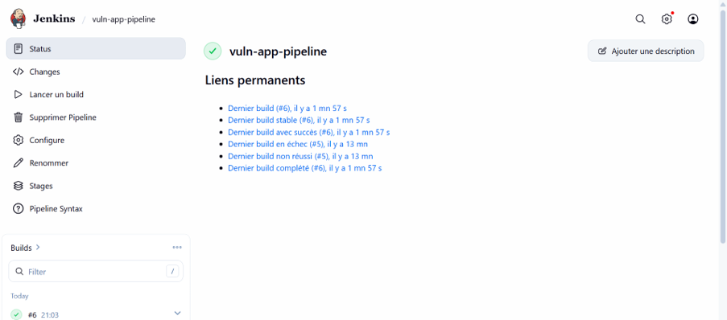

---

## 🛠️ Résumé des actions

| Étape | Outil | Action |
| :--- | :--- | :--- |
| **Secrets** | Gitleaks, pre-commit | Détection et blocage des secrets. |
| **SAST** | Semgrep, CodeQL | Analyse du code (SQLi, XSS, etc.). |
| **SCA** | npm audit, OWASP, Dependabot | Audit des dépendances. |
| **Images** | Trivy | Scan des CVE et du Dockerfile. |
| **Gouvernance** | GitHub | Rulesets, Dependabot, CodeQL. |
| **CI/CD** | Jenkins | Quality gates (Rouge/Vert). |

---

  <b>Fait avec ❤️ par Arij Belaid</b>

